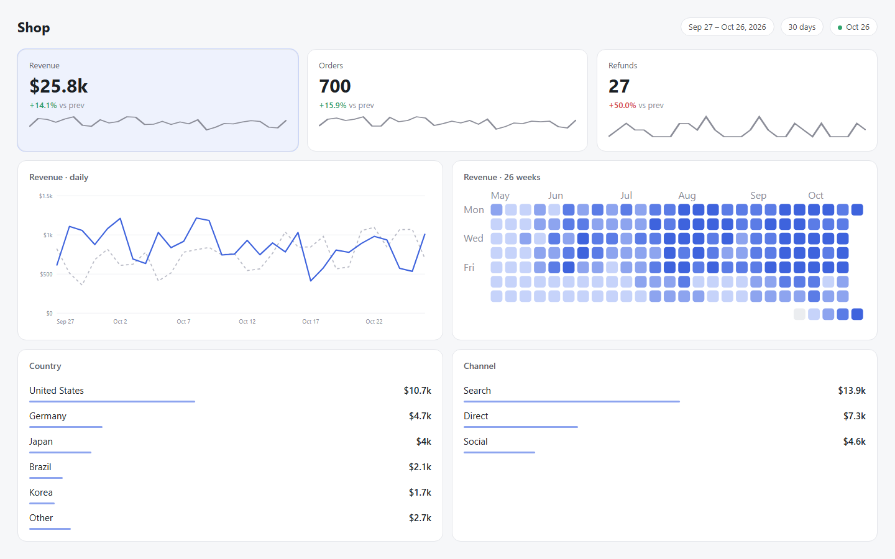
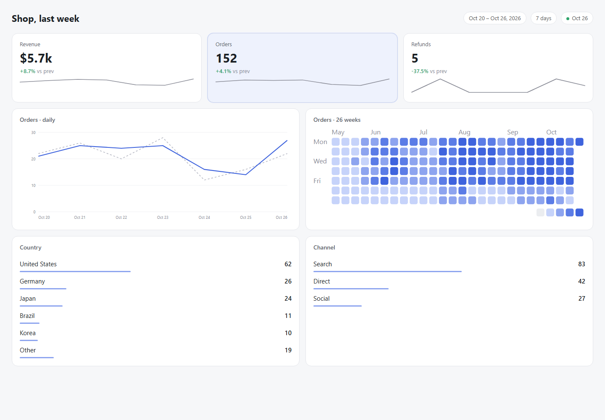
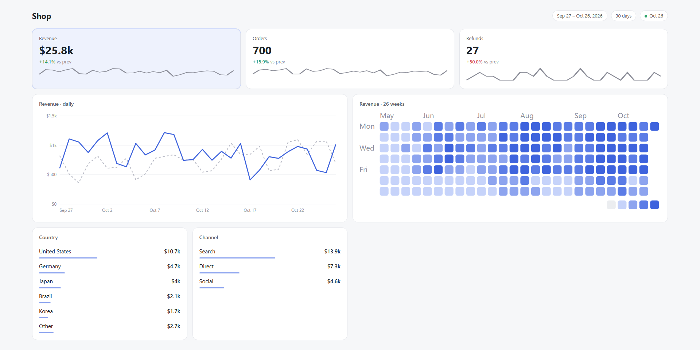

<div align="center">

# csv2dash

**Turn any CSV with a date column into a clean, honest dashboard: one HTML file, one command.**

The rules a senior product designer uses for data screens (round ticks, honest deltas, no sentences) plus a GitHub-style activity grid, applied for you.

Works with **Claude Code** and **Codex**.

 



</div>

## Quick start
```bash
git clone https://github.com/Dodai0419/csv2dash && cd csv2dash
python csv2dash.py examples/shop.csv --value revenue --lower-better refunds
```
```
examples\shop.html  4410 rows, Sep 27 - Oct 26, 2026
  tiles: revenue, orders, refunds  |  chart + grid: revenue  |  breakdowns: country, channel
  words audit: 0 sentence(s) on screen
```
Open `examples/shop.html`. No server, no JavaScript, no packages: Python 3.8+ only.

## Gallery

| Command | Result |
|---------|--------|
| `python csv2dash.py examples/shop.csv --value revenue --lower-better refunds` |  |
| `python csv2dash.py examples/shop.csv --value orders --days 7 --lower-better refunds --title "Shop, last week"` |  |
| the first dashboard on a 1920 px screen |  |

Every image is a headless-Edge screenshot of the HTML file the command wrote. The demo data comes from `examples/make_data.py` (seeded, so it never changes).

## The problem
- A quick dashboard from an agent usually means a sentence under every number, axis ticks like 2,103 and 1,402, and a red **-100%** when one sale became zero.
- "Up 14%" means nothing until you know "compared to what": most quick charts never show the previous period.
- Spinning up Metabase, a notebook or a React app to look at one CSV is too much.

## The solution
| Idea | Fixes |
|------|-------|
| **KPI tiles against the previous period of the same length** (30 days vs the 30 before) | every number answers "compared to what?" |
| **Honest deltas**: a base under 5 reads "was 1" in grey; `--lower-better` flips green and red for cost, churn, refunds; `--neutral` keeps spend grey | no shouting -100% on tiny numbers, no green for rising costs |
| **Round ticks and compact numbers**: 0, 500, 1k; $25.8k on the tile, exact values in tooltips | axes you can read at a glance |
| **Previous period as a dashed grey line** behind the current one | trend and baseline in one chart |
| **GitHub-style 26-week grid** with five classed tiers (quartiles of active days) | weekly rhythm and quiet stretches at a glance |
| **Ranked breakdowns with slim 3 px share bars** for every text column, top 5 plus "Other" | what drives the number, without a pie chart |
| **Words audit**: counts sentences on screen (target 0); explanations live in hover tooltips | the page speaks in numbers and shapes |

## How columns are read
- **Date column**: the first column where the values look like `YYYY-MM-DD` (or pass `--date`).
- **Numeric columns** become KPI tiles. The first one (or `--value`) drives the chart, the grid and the breakdowns.
- **Text columns** become ranked breakdowns of `--value` over the current period.
- **Money** columns are guessed from names like revenue, sales, amount, cost, spend (or pass `--money a,b`).
- Rows on the same day are summed, so per-order rows and per-day rows both work.

## Use with Claude Code
```bash
/plugin marketplace add Dodai0419/csv2dash
/plugin install csv2dash@csv2dash
```
Then: "make a dashboard from sales.csv, refunds are lower-is-better".

## Use with Codex (ChatGPT)
```bash
git clone https://github.com/Dodai0419/csv2dash && cp -r csv2dash/skills/* ~/.codex/skills/
```
Or copy `AGENTS.md` into your project root.

## Benchmarks
| | dashboard-design-skill | hermes-activity | csv2dash |
|-|-|-|-|
| what it is | rules for an agent (no code) | Hermes Desktop plugin (React + Python + TypeScript collectors) | one Python script |
| input | whatever the agent builds | Hermes `state.db` only | any CSV with a date column |
| needs | an agent writing React + Tailwind per dashboard | Hermes Agent >= 0.21.7, Node >= 22.18, npm build | Python 3.8+ |
| source lines | 0 | 3,577 (`.py/.ts/.tsx`, tests excluded) | **211** |
| `examples/shop.csv` (4,410 rows) -> dashboard | not measured | not runnable on a CSV | 118-205 ms |

Reproduce: `python bench/bench.py` (3 runs of 20 builds). Measured on Windows 11, Python 3.11.1, with the CPU busy with other jobs. Lines counted with `git ls-files ... | xargs cat | wc -l`.

## Tests
```bash
python -m unittest -q
```
13 tests: compact numbers, round ticks, "was N" on tiny bases, flipped colours for lower-is-better, same-length periods, sorted breakdowns with share bars, heatmap tiers, HTML escaping, and a demo that must pass the words audit with 0 sentences.

## Known limits
- One chart and one grid per page, both on `--value`. Run it twice for two metrics.
- No date range picker or filters: the page is static. Re-run with `--days`.
- No dark mode yet.

## Inspired by
- [abdiraimov-otabek/dashboard-design-skill](https://github.com/abdiraimov-otabek/dashboard-design-skill) (MIT): the rules (compared to what, "was 1" not -100%, round ticks, slim share bars, quiet colour, wordless with tooltips, the words audit) and the house style.
- [hassan-kamel/hermes-activity](https://github.com/hassan-kamel/hermes-activity) (MIT): the GitHub-style daily contribution grid, totals and ranked breakdowns of an activity dashboard.

## Roadmap
- [ ] `--compare target.csv` for bullet graphs against targets
- [ ] dark mode from `prefers-color-scheme`
- [ ] one page per metric with tabs

## License
MIT
